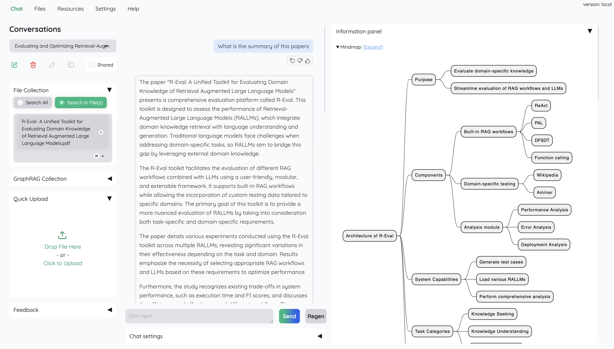

# Getting Started with DocHelper

This page is intended for **end users** who want to use DocHelper for question
answering on local documents. If you are a **developer** who wants to extend the
project, please visit the [development](development/index.md) page.

## Installation

Clone the repository, then set up the environment from the repository root.

### Option 1: Using uv (recommended)

```shell
uv sync --python 3.10
source .venv/bin/activate     # Windows: .venv\Scripts\activate
```

### Option 2: Using conda

```shell
conda create -n dochelper python=3.10
conda activate dochelper

pip install -e "libs/dochelper[all]"
pip install -e "libs/dochelper_app"
```

### Option 3: Setup scripts

Navigate to the `scripts` folder and run the installer that matches your OS:

- Windows: `run_windows.bat` — double click the file.
- macOS: `run_macos.sh`
- Linux: `run_linux.sh` — run `bash run_linux.sh` in your terminal.

These scripts create a conda environment and install from source, so run them
from a full checkout of the repository.

## Configuration

Copy `.env.example` to `.env` in the repository root and fill in the API keys
you need. The file is read once on first run to populate the database;
afterwards, settings are managed in the UI.

## Launch

```shell
python app.py
```

The application opens automatically in your browser and greets you with this
screen:



Default login information is `username: admin / password: admin`. Change this
credential right after the first login.

## Usage

For how to use the application, see [Usage](usage.md). This page is also
available within the application itself.
